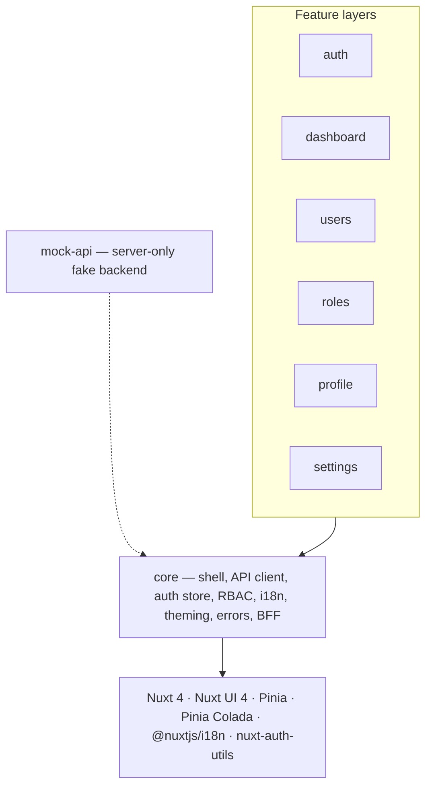
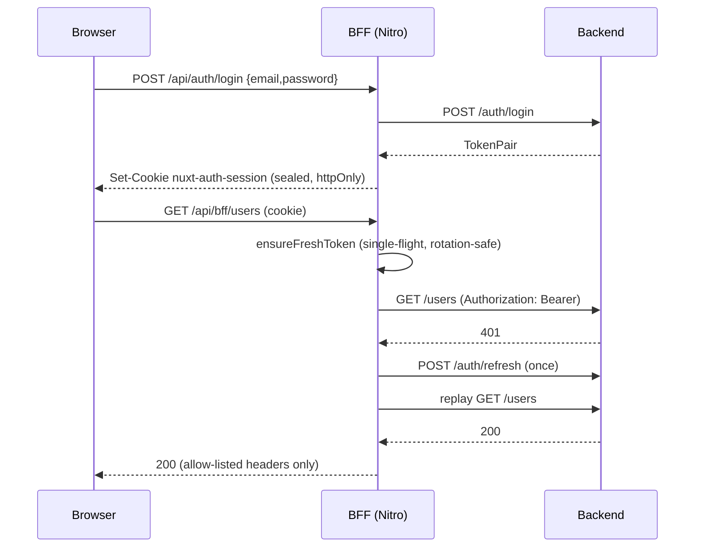

# Architecture

## Layers



Rules (enforced by `scripts/check-boundaries.mjs`, part of `pnpm lint`):

- feature → core → libraries. Core never references a feature; features never reference each other.
- Everything a feature exports is prefixed: `Users*` components, `useUsers*` composables, `users.*` i18n keys.
- Features plug in only through pages, the `navigation` / `commands` / `userMenu` registries in
  their `app/app.config.ts`, their i18n files and `AppPermissions` augmentation.
- Adding a feature = `pnpm new:feature <name>`. Removing one = deleting its folder.

## Data flow

```mermaid
flowchart LR
  page[Page] --> comp[Feature composable] --> colada[Pinia Colada query / mutation]
  colada --> api[createXApi(client)] --> client[useApiClient → $api]
  client -->|/api/bff/**| bff[BFF Nitro route]
  bff -->|Bearer token| backend[(REST backend)]
  colada -. errors .-> bus[error bus] --> policy[handleApiError → toast / redirect]
```

- Server state lives only in Pinia Colada; Pinia setup stores hold client state (`auth`, `appearance`).
- Every failure is an `ApiError`; `handleApiError` is the single error policy.

## Auth & refresh



- Tokens never reach JavaScript. Cookies never cross the BFF in either direction.
- CSRF: `X-Requested-With: fetch` + content-type allow-list + same-origin check on every unsafe `/api/**`.
- Refresh state is per process. **Multi-instance deployments**: set `NUXT_AUTH_TOKEN_STORE=storage`,
  configure a shared Nitro storage driver for `auth-tokens` (e.g. Redis) and add a distributed lock.

## Guards

1. `01.auth.global` — public pages pass; guest pages bounce logged-in users through
   `useHomeRoute()`; everything else needs a session and loads `/me` once.
2. `02.permissions.global` — `definePageMeta({ permissions, permissionMode })` → fatal 403.

Navigation visibility is derived from the **route meta** of each item's `to`, so menus and guards
cannot disagree. After every `/me` refetch the current route is re-checked.

## Enabling SSR later

The code avoids module-scope reactive state and uses cookies for persisted preferences. To turn
on SSR: set `ssr: true`, forward cookies on server fetches (`useRequestHeaders(['cookie'])`), and
add a server middleware that runs `ensureFreshToken()` before rendering authenticated pages.
